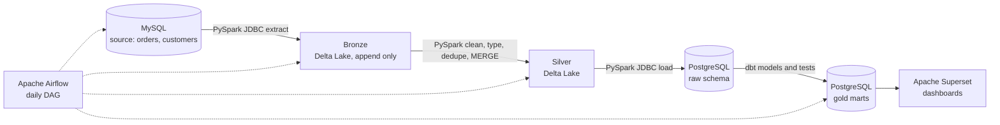

# Batch Lakehouse Pipeline in Docker

A batch data engineering pipeline that runs entirely on your machine from one `docker compose` file. It extracts orders and customers from a MySQL source with PySpark, stores them in Delta Lake bronze and silver layers, loads a PostgreSQL warehouse, builds gold marts and tests with dbt, and serves dashboards in Apache Superset. Apache Airflow runs everything on a daily schedule.

Every tool is free and open source.

## Architecture



## Medallion layers

| Layer | Where | What it holds |
|---|---|---|
| Bronze | Delta Lake (`lakehouse/bronze`) | Raw MySQL extracts, append only. Every version of every row is kept, with `_ingested_at` and `_batch_id` columns. |
| Silver | Delta Lake (`lakehouse/silver`) | Cleaned, typed, deduplicated rows. One current row per key, kept up to date with `MERGE`. |
| Gold | PostgreSQL (`gold` schema) | dbt marts built for dashboards: customers, orders, daily sales, and sales by state. |

## What the daily DAG does

The Airflow DAG `batch_lakehouse_pipeline` runs four tasks in order:

1. **simulate_source_activity** inserts new orders into MySQL and moves some open orders to shipped or completed, so every run has new and changed data to process.
2. **spark_bronze_extract** reads only rows whose `updated_at` is at or after the newest one already in bronze (an incremental watermark) and appends them to bronze.
3. **spark_silver_transform** cleans the bronze data (trims and lowercases emails, standardizes names, states, and statuses, drops invalid orders), keeps the latest version of each record, and `MERGE`s it into silver. It then loads silver into the Postgres `raw` schema.
4. **dbt_build** builds the staging views and gold mart tables, and runs 20 data tests: uniqueness, not-null, accepted values, a foreign key check between orders and customers, and a custom check for negative revenue.

## Requirements

- [Docker Desktop](https://www.docker.com/products/docker-desktop/) (free for personal use)
- About 8 GB of memory available to Docker, and 10 GB of disk space
- Internet access on the first run, to download the images and Spark's Delta Lake and JDBC jars

## Run it

```bash
cp .env.example .env
docker compose up -d --build
```

The first build takes several minutes. When it's done:

| Service | URL | Login |
|---|---|---|
| Airflow | http://localhost:8080 | admin / admin |
| Superset | http://localhost:8088 | admin / admin |
| MySQL | localhost:3306 | shop / shoppass |
| PostgreSQL | localhost:5432 | warehouse / warehousepass |

Then:

1. Open Airflow, switch on `batch_lakehouse_pipeline`, and click the play button to trigger a run.
2. Watch each task turn green. The first Spark task takes longer while it downloads its jars.
3. Trigger it a second time. Bronze appends only the new and changed rows, and silver updates the orders whose status changed.

On Linux, set `AIRFLOW_UID` in `.env` to the output of `id -u` before starting, so files written to `lakehouse/` and `dbt/` belong to your user.

## Build the dashboard in Superset

1. Go to **Settings → Database Connections → + Database → PostgreSQL**.
2. Use host `postgres`, port `5432`, database `warehouse`, username `warehouse`, password `warehousepass`.
3. Go to **Datasets → + Dataset** and add `gold.mart_daily_sales`, `gold.mart_sales_by_state`, and `gold.dim_customers`.
4. Build charts, for example daily revenue over time, average order value, cancel rate, revenue by state, and customers by segment. Then put them on one dashboard.

## Check the data yourself

```bash
# Gold marts in Postgres
docker compose exec postgres psql -U warehouse -d warehouse -c "select * from gold.mart_daily_sales order by order_day desc limit 10;"

# Bronze keeps every version; silver has one row per order
docker compose exec airflow-scheduler python -c "
from pyspark.sql import SparkSession
from delta import configure_spark_with_delta_pip
b = SparkSession.builder.config('spark.sql.extensions','io.delta.sql.DeltaSparkSessionExtension').config('spark.sql.catalog.spark_catalog','org.apache.spark.sql.delta.catalog.DeltaCatalog')
s = configure_spark_with_delta_pip(b).getOrCreate()
print('bronze orders:', s.read.format('delta').load('/opt/lakehouse/bronze/orders').count())
print('silver orders:', s.read.format('delta').load('/opt/lakehouse/silver/orders').count())"
```

## Project structure

```
batch-lakehouse-pipeline/
├── docker-compose.yml            # every service in one file
├── .env.example                  # passwords and settings
├── docker/
│   ├── airflow/                  # Airflow image with Java, PySpark, Delta Lake, and dbt
│   └── superset/                 # Superset image with the Postgres driver
├── init/
│   ├── mysql/                    # source tables and seed data (500 customers, 5,000 orders)
│   └── postgres/                 # warehouse schema and Airflow's database
├── dags/batch_lakehouse_pipeline.py
├── jobs/
│   ├── common.py                 # Spark session and connection settings
│   ├── bronze_extract.py         # MySQL -> bronze (incremental)
│   └── silver_transform.py       # bronze -> silver (MERGE) -> Postgres raw
├── scripts/generate_orders.py    # simulates daily source activity
├── dbt/
│   ├── models/staging/           # views over the raw tables
│   ├── models/marts/             # gold tables for dashboards
│   └── tests/                    # custom data tests
└── lakehouse/                    # Delta Lake files (created on the first run)
```

## Stop or reset

```bash
docker compose down          # stop everything, keep the data
docker compose down -v       # stop and delete all data
rm -rf lakehouse/bronze lakehouse/silver   # also clear the Delta Lake files
```

## Tools

Python, PySpark, Delta Lake, SQL, MySQL, PostgreSQL, dbt Core, Apache Airflow, Apache Superset, Docker Compose
